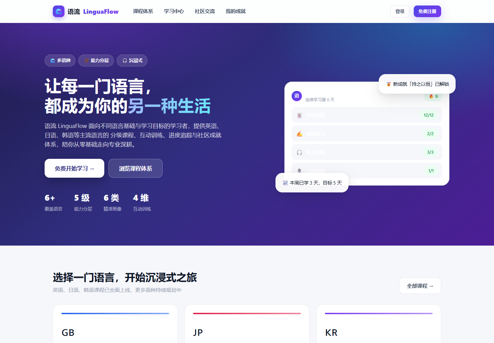
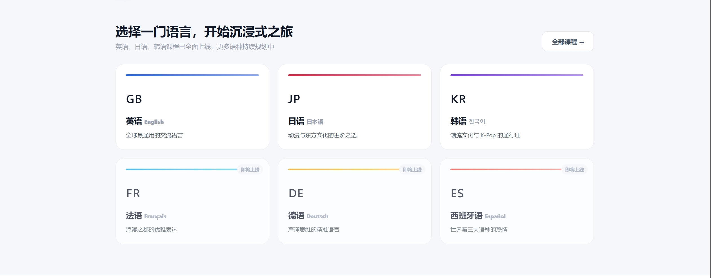
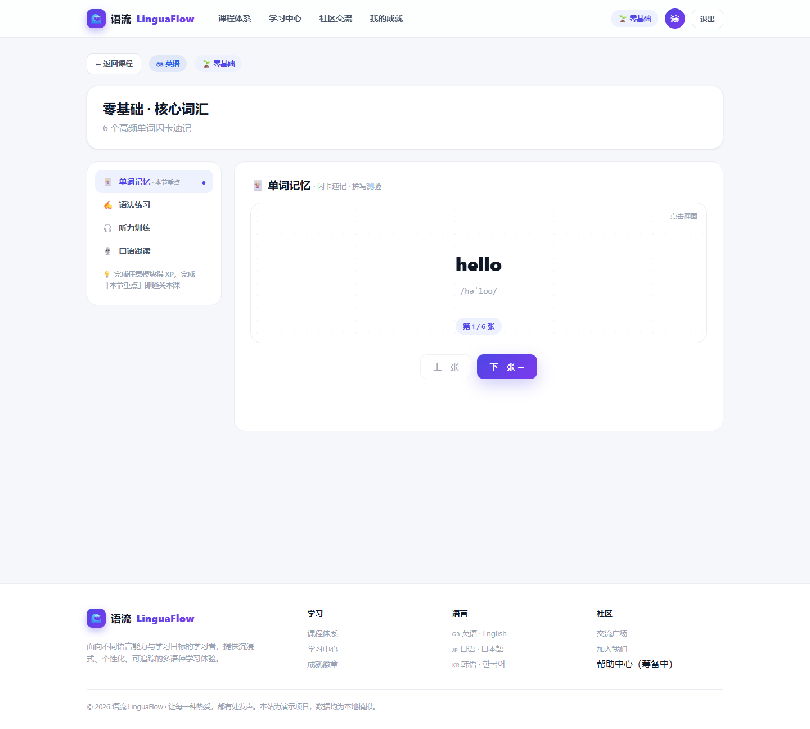
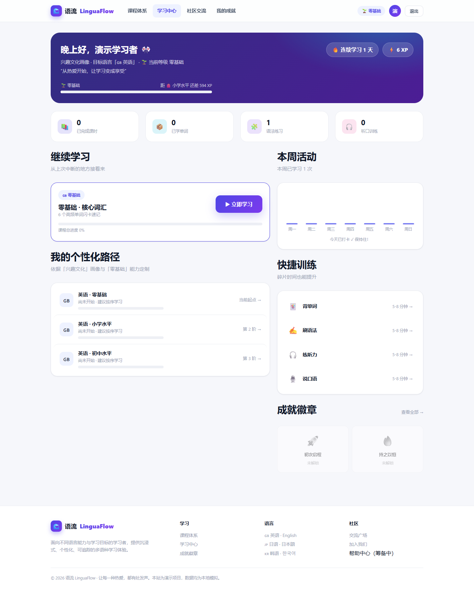
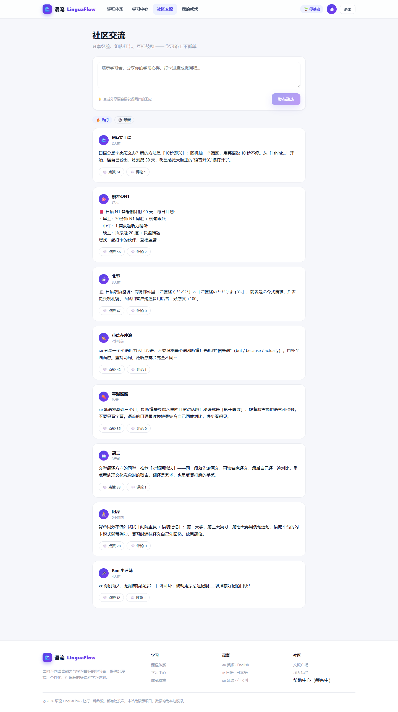
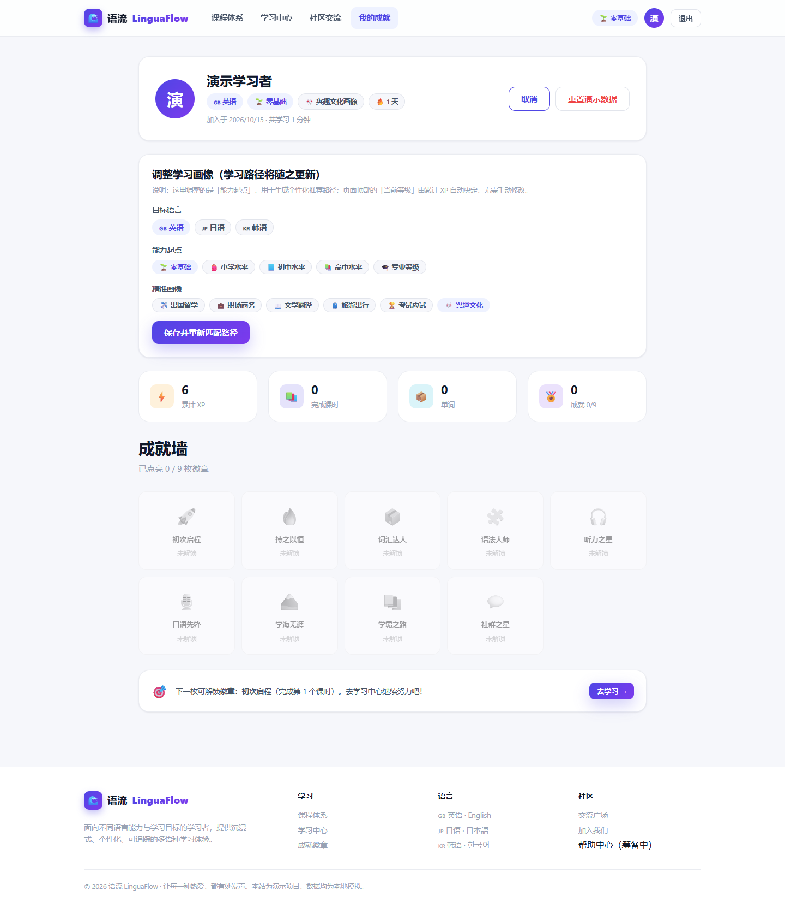

# 语流 LinguaFlow · 多语种沉浸式在线学习平台

面向不同语言基础与学习目标的学习者，提供英语、日语、韩语等主流语言的**分级课程**、**四维互动训练**、**学习进度追踪**、**个性化路径推荐**与**社区成就体系**，陪学习者从零基础走向专业深耕。

- **在线体验：** https://mildseven148.github.io/linguaflow/
- **仓库地址：** https://github.com/MildSeven148/linguaflow

## 课程提交材料

| 材料 | 文件 |
| --- | --- |
| 需求、设计及选题完善说明 | [Project_Requirements_and_Design.md](Project_Requirements_and_Design.md) |
| AI 结对编程与 Vibe Coding 过程 | [AI_Prompts_Log.md](AI_Prompts_Log.md) |
| 仓库链接 | [Repository_Link.txt](Repository_Link.txt) |
| 提交、分支和 PR 历史快照 | [Git_Workflow_Records.md](Git_Workflow_Records.md) |
| 界面、业务逻辑及数据源码 | src/；桌面启动器与构建源码见 tools/ |

本 README 下文包含图文运行指南、六张实际页面截图及团队分工。


---

## 项目简介

语流 LinguaFlow 是一个纯前端实现的多语种学习平台。核心思路是「先分层、再画像」：学习者先确定自己的**语言能力起点**，再选定**学习目标画像**，系统据此生成个性化的推荐学习路径，让每一次学习都直指目标。

项目无需后端即可完整运行——用户体系、学习进度、成就徽章与社区数据通过浏览器 `localStorage` 持久化，适合直接演示与二次开发。

---

## 六大核心能力

| 能力 | 说明 |
| --- | --- |
| **1. 分级课程体系** | 五档能力分层 × 多语种，每门课程含完整课时与学习目标 |
| **2. 互动式学习模块** | 单词记忆、语法练习、听力训练、口语跟读四维训练 |
| **3. 学习进度追踪** | XP 累计、连续打卡、学习时长、四维训练统计、课程完成度 |
| **4. 用户注册登录** | 注册 / 登录 / 会话保持，注册后进入能力测评与画像选择 |
| **5. 个性化路径推荐** | 按「能力起点 + 目标画像」双维度加权，生成专属课程顺序 |
| **6. 社区交流与成就激励** | 发帖、评论、点赞；9 枚成就徽章 + 连续打卡激励 |

---

## 分级体系

按语言能力分为五档，能力起点决定推荐路径，页面顶部「当前等级」由累计 XP 自动晋升。

| 等级 | 标识 | 定位 | 内容侧重 | 解锁 XP |
| --- | --- | --- | --- | --- |
| 零基础 | `starter` | 从零开始 | 字母发音、最基础词汇与日常寒暄 | 0 |
| 小学水平 | `elementary` | 打牢地基 | 基础词汇、简单句型与生活场景表达 | 600 |
| 初中水平 | `junior` | 日常会话 | 高频词汇、核心语法与情景对话 | 1600 |
| 高中水平 | `senior` | 进阶提升 | 进阶语法、学术词汇与流畅表达 | 3200 |
| 专业等级 | `advanced` | 专业深耕 | 母语级表达、领域语料与思辨能力 | 6400 |

## 精准画像体系

按客户真实需求细分六类画像，每类画像配有关键词方向与专属学习寄语，并影响推荐路径的等级权重。

| 画像 | 标识 | 需求描述 | 关注方向 |
| --- | --- | --- | --- |
| 出国留学 | `abroad` | 备考冲刺、学术写作与海外校园生活场景 | 雅思 / 托福、学术写作、校园口语 |
| 职场商务 | `career` | 商务会议、邮件沟通与跨文化协作表达 | 商务会话、邮件写作、面试表达 |
| 文学翻译 | `translation` | 文学鉴赏、翻译技巧与双语思维深度训练 | 文本精读、翻译练习、文化意象 |
| 旅游出行 | `travel` | 出行必备表达与目的地文化融入 | 问路点餐、住宿出行、文化礼仪 |
| 考试应试 | `exam` | 系统备考规划与高效提分策略 | 题型训练、词汇攻坚、真题解析 |
| 兴趣文化 | `interest` | 从影视、动漫与音乐中轻松进阶 | 追剧学语言、歌词跟唱、社交表达 |

## 语言与课程规模

- **已上线**：英语 `en`、日语 `ja`、韩语 `ko`
- **规划中**：法语 `fr`、德语 `de`、西班牙语 `es`
- **课程规模**：3 语种 × 5 级 = **15 门课程** × 每门 4 课时 = **60 个课时**
- **课时内容**：每个课时均包含单词、语法、听力、口语四类完整内容，可自由切换训练模块
- **成就徽章**：9 枚（初次启程、持之以恒、词汇达人、语法大师、听力之星、口语先锋、学海无涯、学霸之路、社群之星）

---

## 技术栈

| 层面 | 选型 |
| --- | --- |
| 框架 | React 18 |
| 构建 | Vite 5 |
| 路由 | react-router-dom 6（Vite 版用 BrowserRouter / 单文件版用 HashRouter） |
| 状态管理 | React Context（`AppProvider` / `useApp`） |
| 样式 | 原生 CSS 设计系统（CSS 变量、渐变、卡片、动画、响应式断点） |
| 数据层 | 前端 Mock 数据 + `localStorage` 持久化 |
| 语音合成 | Web Speech API（`speechSynthesis`），浏览器原生发声 |
| 口语录音 | Web Audio API 采集 PCM，手工编码 WAV，跨浏览器可播放 |

---

## 快速开始

### 方式一：在线访问（最省事）

直接打开：https://mildseven148.github.io/linguaflow/

### 方式二：免安装单文件版（无需 Node 环境）

双击打开根目录的 `语流学习平台-免安装版.html` 即可。页面、React 和路由依赖、样式均已打包进同一文件，可断网打开，无需安装 Node.js。

### 方式三：Windows 桌面启动器（无需 Node 环境）

双击根目录 `语流学习平台.exe`，程序会启动本地 HTTP 服务并自动打开默认浏览器，不显示命令行窗口。系统托盘图标可双击重新打开页面，右键选择「退出」可关闭服务。

完整页面与运行依赖均已内嵌到 exe，可断网打开。口语录音需允许浏览器访问麦克风；语音示范的可用音色取决于浏览器和系统。启动器源码和编译说明见 [`tools/README.md`](tools/README.md)。

### 方式四：本地开发（完整工程）

需要 Node.js 18+。

```bash
npm install
npm run dev
```

然后访问 http://localhost:5173

Windows 用户也可直接双击 `start.bat` 一键启动（脚本会自动安装依赖，失败时自动切换国内镜像重试）。

其他命令：

```bash
npm run build      # 生产构建
npm run preview    # 预览构建产物
npm run build:single # 生成免安装 HTML，并同步 docs/index.html
```

---

## 目录结构

```
├── docs/
│   ├── index.html                  # GitHub Pages 站点入口（免安装版的部署副本）
│   └── screenshots/                # 六个实际页面的运行截图
├── src/
│   ├── api/
│   │   └── mock.js                 # 本地持久化层（localStorage 模拟后端接口）
│   ├── components/
│   │   ├── Navbar.jsx              # 顶部导航
│   │   ├── Footer.jsx              # 页脚
│   │   ├── Layout.jsx              # 页面骨架
│   │   └── common.jsx              # 通用组件（进度条、撒花动效等）
│   ├── context/
│   │   └── AppContext.jsx          # 全局状态：用户 / 进度 / 成就 / 社区 / Toast
│   ├── mock/
│   │   └── data.js                 # 数据层：分级 / 画像 / 语言 / 课程 / 内容 / 徽章 / 推荐算法
│   ├── modules/
│   │   ├── VocabularyPlayer.jsx    # 单词记忆：闪卡翻转 + 拼写测验
│   │   ├── GrammarPlayer.jsx       # 语法练习：规则精讲 + 即时纠错
│   │   ├── ListeningPlayer.jsx     # 听力训练：语音播放 + 理解检测
│   │   └── SpeakingPlayer.jsx      # 口语跟读：语音示范 + 录音回放
│   ├── pages/
│   │   ├── Home.jsx                # 首页
│   │   ├── Courses.jsx             # 课程体系（按语言 / 分级筛选）
│   │   ├── CourseDetail.jsx        # 课程详情与课时列表
│   │   ├── LessonPage.jsx          # 课时学习页（四模块切换）
│   │   ├── Dashboard.jsx           # 学习中心：进度、路径推荐、成就
│   │   ├── Community.jsx           # 社区交流
│   │   ├── Login.jsx               # 登录
│   │   ├── Register.jsx            # 注册
│   │   ├── Onboarding.jsx          # 能力测评 + 画像选择
│   │   └── Profile.jsx             # 个人中心（画像与能力起点调整）
│   ├── styles/
│   │   └── global.css              # 全局设计系统
│   ├── utils/
│   │   └── tts.js                  # 语音合成封装（speak / stopSpeak）
│   ├── App.jsx                     # 路由配置
│   └── main.jsx                    # 应用入口
├── index.html                      # Vite 开发入口
├── 语流学习平台-免安装版.html        # 免安装单文件版（已内嵌全部运行依赖）
├── 语流学习平台.exe                # Windows 托盘启动器（内嵌单文件页面）
├── tools/                          # 启动器 C# 源码及编译说明
├── start.bat                       # Windows 一键启动脚本
├── package.json
├── vite.config.js
└── .gitignore
```

---

## 页面路由

| 路径 | 页面 | 是否需要登录 |
| --- | --- | --- |
| `/` | 首页 | 否 |
| `/courses` | 课程体系 | 否 |
| `/courses/:courseId` | 课程详情 | 否 |
| `/community` | 社区交流 | 否 |
| `/login` | 登录 | 否 |
| `/register` | 注册 | 否 |
| `/onboarding` | 能力测评与画像选择 | 是 |
| `/lesson/:lessonId` | 课时学习 | 是 |
| `/dashboard` | 学习中心 | 是 |
| `/profile` | 个人中心 | 是 |

---

## 数据与持久化说明

本项目为**前端 + Mock 数据**架构，不含真实服务端：

- 用户、学习进度、成就、社区帖子等数据通过浏览器 `localStorage` 持久化
- 存储键：`linguaflow_db_v4`（业务数据）、`linguaflow_session`（登录会话）
- 清除浏览器站点数据即恢复初始状态
- 替换 `src/api/mock.js` 中的读写实现即可对接真实后端接口

---

## 浏览器要求

建议使用 Chrome / Edge 最新版：

- **听力训练与发音示范**依赖 Web Speech API（`speechSynthesis`），不同系统可用的语音音色有差异
- **口语跟读录音**依赖麦克风权限，需在 `https` 或 `localhost` 环境下使用（GitHub Pages 已满足）
- 若听不到声音或录音为空，请检查浏览器麦克风授权与系统声音设备

---

## 部署说明

站点通过 GitHub Pages 发布：仓库 `Settings → Pages` 中，Source 选择 `Deploy from a branch`，分支 `main`，目录 `/docs`。

运行 `npm run build:single` 会从 `src/` 生成根目录 `语流学习平台-免安装版.html` 和内容相同的 `docs/index.html`；单文件版使用 HashRouter，支持 GitHub Pages 子目录和刷新。脚本将运行依赖和样式内嵌，不需要 CDN。源码变更后重新运行此命令，并按 `tools/README.md` 重新编译 exe，保持三种发布产物一致。

第三方依赖的许可证随单文件 HTML 一并内嵌，同时保存在 `THIRD_PARTY_LICENSES.txt`。

---

## 运行截图

- 在线体验：https://mildseven148.github.io/linguaflow/
- 本地运行：双击根目录 `语流学习平台-免安装版.html`，或执行 `npm run dev` 后访问 http://localhost:5173

> 截图存放位置：`docs/screenshots/`。以下六张图于 2026-10-15 从本地 React 工程的生产构建中实际截取，分别对应首页、课程体系、课时学习、学习中心、社区交流和个人中心；登录页面使用临时演示账号。

### 1. 首页



多语种入口、五档能力分层、六类目标画像与四维训练总览。

### 2. 课程体系



支持按语言与能力分级筛选课程。

### 3. 课时学习



单词 / 语法 / 听力 / 口语四模块自由切换训练。

### 4. 学习中心



XP 与等级、连续打卡、本周活动、个性化路径推荐与成就徽章。

### 5. 社区交流



发帖、评论、点赞互动。

### 6. 个人中心



学习画像与能力起点调整。

---

## 团队分工（汉高组）

| 姓名 | 学号 | 组内角色 | 任务分工 |
| --- | --- | --- | --- |
| 李子谦 | 2610250850 | 项目经理 / 前端架构 | 需求梳理与进度统筹、Git 协作规范制定、文档汇总与 README 编写；项目骨架搭建、路由设计、全局状态管理 |
| 朱贺禹 | 2610250972 | 页面与交互开发 | 首页、课程体系、课程详情、社区、登录注册、学习中心、个人中心等页面；课时学习页的模块切换与学习流程串联 |
| 李旦珂 | 2610251073 | 数据建模与推荐算法 | Mock 数据层与多语种分级内容库；分级 × 画像双维度推荐算法、学习进度追踪、成就徽章判定 |
| 陈国奥 | 2610250694 | 互动模块 / UI·UX / 测试 | 单词记忆、语法练习、听力训练、口语跟读四模块（含语音合成与录音实现）；设计系统与响应式适配、功能测试与演示材料 |

---

## Git 协作记录

- 仓库地址：https://github.com/MildSeven148/linguaflow
- 访问权限：公开（Public）

**一、提交记录**

| 提交 | 说明 |
| --- | --- |
| `469cb6f` | init：初始化仓库结构，提交根目录配置与说明文件 |
| `dab3a85` | feat：提交 `src` 源码目录（组件 / 页面 / 学习模块 / 数据层） |
| `c90658e` | docs：提交项目 README |
| `1368c30` | chore：添加 GitHub Pages 站点入口 |
| `1bda89a` | docs：更新 README 项目说明与在线体验地址 |
| 后续提交 | docs：补充需求与设计文档、AI 辅助编程记录、运行截图、MIT 协议与协作规范（完整历史见仓库提交列表） |

**二、分支与 Pull Request 记录**

| PR | 分支 | 内容 | 合并提交 | 合并日期 |
| --- | --- | --- | --- | --- |
| [#1](https://github.com/MildSeven148/linguaflow/pull/1) | `feature/ui-system` | 补充课时学习页职责说明注释 | `bfb3213` | 2026-10-15 |
| [#2](https://github.com/MildSeven148/linguaflow/pull/2) | `feature/recommend-progress` | 补充本地持久化层接口说明 | `93ba5cd` | 2026-10-15 |
| [#3](https://github.com/MildSeven148/linguaflow/pull/3) | `feature/learn-modules` | 补充四模块容器说明注释（**含冲突解决**） | `92ddfd4` | 2026-10-15 |

三个分支均从 `main` 拉出，经 Pull Request 合入后删除；当前仓库仅保留 `main` 分支。上述三个 PR 的具体改动是模块职责注释，功能代码提交请参阅完整历史，不能将这些注释 PR 单独当作多人功能开发证明。

**三、冲突处理记录**

PR #3 与已合并的 PR #1 修改了同一文件（`src/pages/LessonPage.jsx`）的同一位置，合并时产生冲突，处理过程如下：

1. GitHub 在 PR 页面提示 `This branch has conflicts that must be resolved`
2. 进入网页端 `Resolve conflicts` 编辑器，保留两段注释、删除 `<<<<<<<` / `=======` / `>>>>>>>` 冲突标记
3. 标记为 resolved 后生成合并中间提交 `d5f8f1c`，随后完成合并（合并提交 `92ddfd4`，双亲为 `93ba5cd` 与 `d5f8f1c`）
4. 合并后复查发现冲突标记删除不彻底 —— `>>>>>>> main` 中的 `main` 残留到了 `import` 语句末尾，会导致模块加载报错；已通过后续提交修正

> 该次经历说明：冲突解决后必须重新检查文件内容，不能只看"合并成功"就结束。

**四、协作规范**

1. **分支策略**：`main` 为稳定分支，禁止直接推送；每个功能点从 `main` 拉出独立分支，命名采用 `feature/<模块名>` 或 `docs/<主题>`；合并完成后删除该分支，保持分支列表整洁。

2. **提交信息规范**：采用 `<类型>: <说明>` 格式。类型包括 `feat`（新增功能）、`fix`（缺陷修复）、`docs`（文档）、`style`（样式）、`refactor`（重构）、`chore`（构建与配置）。

3. **Pull Request 流程**：开发者在功能分支完成开发并推送 → 发起 Pull Request 并说明改动内容与自测情况 → 评审确认逻辑正确性与边界情况 → 评审通过后由发起者合并入 `main`，并删除对应分支。

4. **冲突处理约定**：合并前先将 `main` 最新代码合并进自己的分支，就近解决冲突；冲突解决后**必须重新通读改动文件**，确认标记已清除、代码可正常运行，再提交 Pull Request。

> 说明：上述分支工作流在单一 GitHub 账号下实践完成；记录包含 PR 描述和自测说明，没有其他账号的 Approve 记录。自测与多人评审分别记录。

---

## 开源协议

本项目采用 [MIT License](./LICENSE) 开源协议，欢迎用于学习、教学与二次开发。